<p align="center">
  
</p>

```text
ahmed@github:~$ whoami
Ahmed Ibrahim
CS @ Minerva University · 2× SWE Intern @ Dropbox
```

I like problems where correctness is hard to see from the outside: identity and permissions, migration tooling, caching, and anything low-level enough that you can tell when you got it wrong.

### `~/projects`

| | What I've been building |
| :--- | :--- |
| **[From gates to a computer](https://github.com/Ahm3dGI1/hack-computer)** | Exploring computer architecture and low-level systems. |
| **[Giving pixels some physics](https://github.com/Ahm3dGI1/3D-Physics-Engine)** | Rigid bodies and cloth simulation with C++ and OpenGL. |
| **[Finding files without the wait](https://github.com/Ahm3dGI1/gofi)** | A fast, minimal desktop file finder in Rust. |
| **[Getting machines to agree](https://github.com/Ahm3dGI1/dslabs)** | My coursework fork: replication, gossip, total-order broadcast, and a job queue. |

```text
ahmed@github:~$ cat interests
building useful things
understanding what's underneath
finding out why it broke
```

[LinkedIn](https://www.linkedin.com/in/ahmed-gi/) · [LeetCode](https://leetcode.com/u/AhmedGI/) · [Email](mailto:a.ibrahim@uni.minerva.edu)
